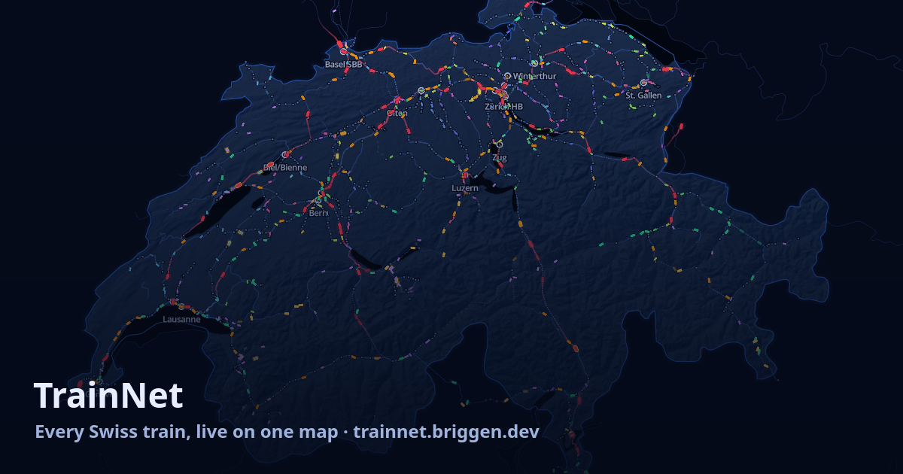

# TrainNet

**Every Swiss train, live on one map.** → [trainnet.briggen.dev](https://trainnet.briggen.dev)



TrainNet draws all ~14,000 trains of a Swiss service day where they are right now, on the real tracks, with their live delay.
A second site, [/stats](https://trainnet.briggen.dev/stats), keeps the history: punctuality back to 2018, records, the fleet.
Everything comes from open data. There is no tracking, no account and no build step.

## On the map

- **Live positions.** Every train runs between its stops along the actual OpenStreetMap track: through station throats and onto its platform, slower over slow bridges, faster on the open line. Positions come from the timetable plus the live forecast (GTFS-RT, every 15 s).
- **The whole track network** from zoom 11: main lines, station tracks, yards. Tunnels are dashed, bridges are cased, and tracks under construction show their opening year.
- **Trains.** Each train has a panel with its stops, platforms, live delay, forecast occupancy and coach formation: sectors, the restaurant, the trainset with a photo of its type. Every category is explained ("GPX: GoldenPass Express").
- **Disruptions.** Operator alerts are drawn on the affected lines. Trains that are probably standing (their expected delay keeps rising) are flagged.
- **Near me.** Finds the trains around you, and notices when your location is moving along a line, which usually means you're on that train.
- **Overlays:**
  - where trains lose time (30 days of recorded runs);
  - trains a day per line section, freight included;
  - line speed.

## On the stats site

- **Punctuality** by day, line, station, train and train type. The history comes from the official actual-time data (Ist-Daten), back to 2018.
- **Calendar and records:** the calendar of good and bad days, records, and the lines that improved or worsened most.
- **Commute:** how reliable your commute is.
- **Network and fleet:** busy hours at stations, and every trainset with its runs. Train types get a photo, a description and where they usually run.

## How it works

```
GTFS static (daily) ──► server/gtfs.ts ──► day payload: stations, trips, platform-to-platform track paths
GTFS-RT (15 s) ───────► server/realtime.ts ──► /api/live: delays, cancellations, alerts
OSM rail (weekly) ────► scripts/rail.ts ──► track graph (routing) + vector tiles (drawing)
Ist-Daten (daily) ────► server/history.ts ──► stats.db (bun:sqlite) ──► /api/stats/*
```

- **Server:** [Bun](https://bun.sh) with `bun:sqlite`, no framework. It keeps the day in memory and routes every platform-to-platform leg once on the OSM graph, then caches it.
  - The router is a turn-aware A\*: trains don't reverse at switches, and they avoid yards.
  - Stops snap onto the track that carries their platform number.
- **Client:** plain ES modules, [MapLibre GL](https://maplibre.org) for the map and [Observable Plot](https://observablehq.com/plot/) for the charts. Train positions are interpolated every frame along the stored paths.
- **Track data:** the server rebuilds it weekly, from OpenStreetMap via Overpass plus swisstopo's lake shores. The new graph and tiles are swapped in at midnight together with the next day's timetable, so the drawn tracks and the trains' paths always match.

## Running it

You need [Bun](https://bun.sh) 1.4+. GDAL is only needed to build the track tiles.

```bash
bun install
cp .env.example .env      # add your opentransportdata.swiss API keys, or set LIVE_FROM (see the file)
bun scripts/rail.ts --tiles   # track graph + tiles into data/ (one Overpass request, ~2 min; needs ogr2ogr)
bun server/index.ts       # http://localhost:3000
bun test
```

The first start downloads the timetable (~290 MB zip) and parses it in about 30 s. Later starts on the same day read it back in about a second.

**Production:** `compose.yml` runs the container behind a Traefik reverse proxy, and `scripts/deploy.sh` ships a checkout and waits until it serves again. Data lives in `./data`: the track graph, route cache and `stats.db`.

## Layout

| Path | What's in it |
|---|---|
| `server/` | HTTP server and API (`index.ts`), timetable (`gtfs.ts`), realtime (`realtime.ts`), routing (`paths.ts`), history and stats (`record.ts`, `history.ts`, `stats.ts`), SBB open data (`sbbdata.ts`), formations (`details.ts`, `fleet.ts`), tiles (`tiles.ts`) |
| `public/` | The map (`index.html`, `app.js`, `position.js`) and the stats site (`stats.html`, `stats.js`), served as is |
| `scripts/` | Track data (`rail.ts`, `railcheck.ts`), the history backfill (`backfill.ts`), type photos (`typephotos.ts`), deploy |
| `test/` | `bun test` |

## Data and credits

| Source | Used for | Licence |
|---|---|---|
| [opentransportdata.swiss](https://opentransportdata.swiss): GTFS, GTFS-RT, service alerts, formations, Ist-Daten, occupancy | Timetable, live delays, disruptions, coaches, history | Open data, attribution required |
| [SBB open data](https://data.sbb.ch) | Passenger counts, rolling stock register, trains per line section, platform sectors and edges | [SBB open data licence](https://data.sbb.ch/page/licence) |
| [OpenStreetMap](https://www.openstreetmap.org/copyright) contributors | Track network, line speeds, tunnels and bridges | ODbL |
| [swisstopo](https://www.swisstopo.admin.ch) | Hillshade (swissALTI3D), lake shores (swissTLM3D) | Free geodata, © swisstopo |
| [Natural Earth](https://www.naturalearthdata.com) | Borders, lakes beyond Switzerland | Public domain |
| [Wikimedia Commons](https://commons.wikimedia.org) | Train type photos; each photo's author and licence is shown with it and listed in `public/types/photos.json` | CC BY / CC BY-SA |

TrainNet is an independent project. It isn't affiliated with SBB or any other railway.

## Licence

[GPL-3.0](LICENSE)
